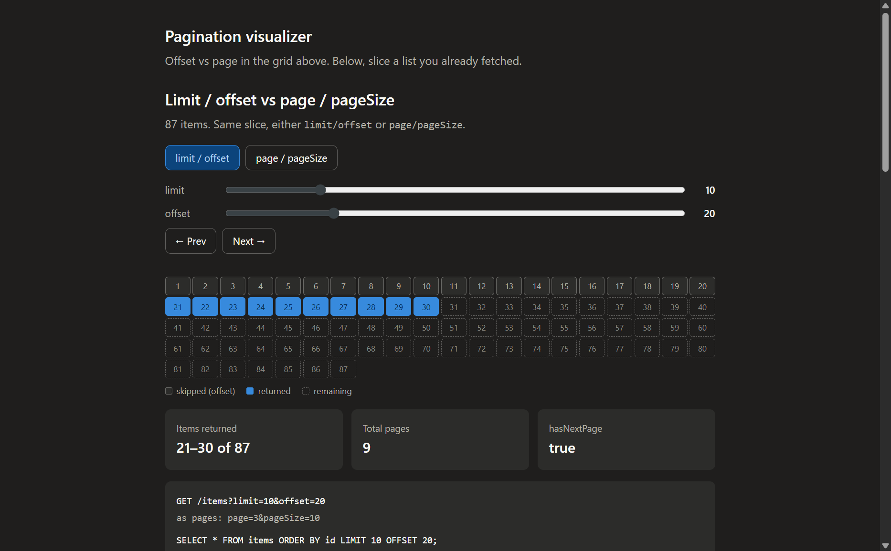

# Pagination visualizer



React + Vite + TypeScript. One list of N rows. Drag sliders and see whether `limit`/`offset` and `page`/`pageSize` mean the same window.

The grid, query string, and SQL line up. Page APIs assume windows start on a boundary. Crank offset to something that isn't a multiple of limit and page mode has nothing honest to call that slice.

When they agree: `offset = (page - 1) * pageSize`.

Scroll for snippets and a live demo: fetch 10,000 rows once with React Query, page with `array.slice`.

## Long lists (client-side)

- Top section: [`src/components/PaginationVisualizer.tsx`](src/components/PaginationVisualizer.tsx) + [`src/pagination.ts`](src/pagination.ts)
- Bottom guide: [`src/components/ClientPaginationGuide.tsx`](src/components/ClientPaginationGuide.tsx), [`src/guide/clientPaginationSnippets.ts`](src/guide/clientPaginationSnippets.ts), [`src/hooks/useItemsQuery.ts`](src/hooks/useItemsQuery.ts), [`src/hooks/useClientPagination.ts`](src/hooks/useClientPagination.ts)
- Mock fetch: [`src/api/items.ts`](src/api/items.ts) (`@tanstack/react-query` is only required for the guide demo)

## Run it

```bash
pnpm install
pnpm dev
```

## Build

```bash
pnpm build
pnpm preview
```
